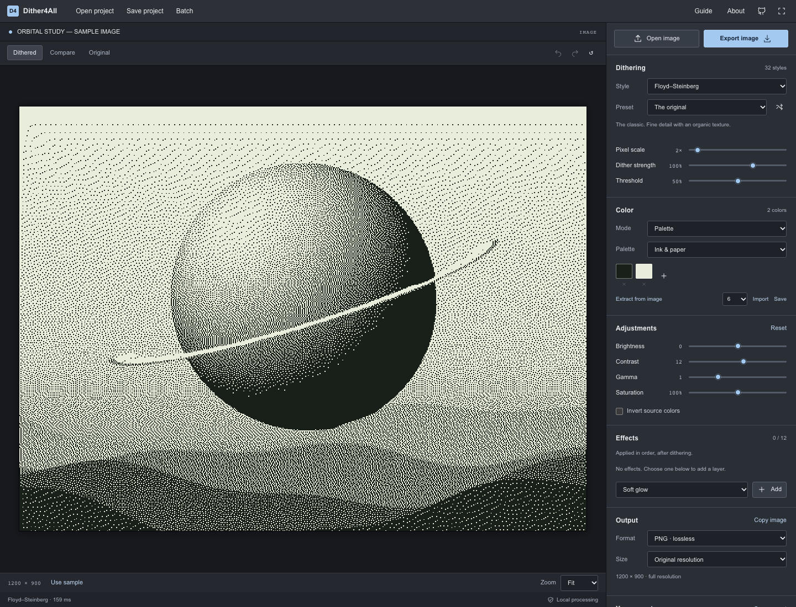

# Dither4All

**Free online dither.** An open-source image studio that runs entirely in your browser.

No account. No image uploads. No paid tier. MIT licensed.

[Open the editor](https://gorskiz.github.io/Dither4All/) · [Report a bug](https://github.com/Gorskiz/Dither4All/issues)



## Development

```sh
npm ci
npm run dev
npm test
npm run build
```

Requires Node.js 22.12+; Node.js 24 is used in CI.

## What you can make

- **32 dithering modes:** 15 error-diffusion modes (including three serpentine variants), five ordered matrices, nine pattern screens including CMYK, and three threshold/noise modes.
- **24 stackable effects:** glow, bloom, chromatic aberration, RGB split, scanlines, grain, vignette, color adjustments, distortion, glitch, edge ink, and more. Toggle, reorder, or adjust up to 12 layers.
- **Color:** 12 built-in palettes, editable 2–16-color palettes, median-cut extraction, RGB quantization, and JSON/hex/GIMP palette imports and exports.
- **Image adjustments:** pixel scale, strength, threshold, pattern size, brightness, contrast, gamma, saturation, inversion, and a reproducible random seed.
- **Workflow:** a continuous photo-editor inspector beside a persistent canvas, before/after comparison, zoom, undo/redo, drag and drop, clipboard paste/copy, five starting presets, saved browser presets, portable preset files, and settings links.
- **Files:** PNG/JPEG/WebP, SVG pixel-run paths in color or black ink, embedded-image `.d4a` project files, and batch processing to a ZIP.

All image decoding and processing happens on your device. No accounts, telemetry, remote fonts, image uploads, API keys, or backend. The host still receives ordinary requests to load the app. Local presets use browser storage. Shared settings links contain no image; project files do contain the source image.

## Running and contributing

```sh
npm run dev                 # local editor
npm test                    # deterministic engine and file tests
npx playwright install chromium
npm run test:browser        # complete browser workflows
npm run build               # type check and static production build
npm run preview             # serve the production build
```

`dist/` is portable static output. GitHub Actions checks the source and deploys `main` to GitHub Pages when Pages is enabled with the GitHub Actions source. No hosting credentials are needed in the source.

See [CONTRIBUTING.md](CONTRIBUTING.md), the [architecture](docs/architecture.md), [feature scope](docs/features.md), and [algorithm references](docs/algorithms.md).

## Practical limits

- Input: 50 MB, 16 megapixels, at most 8192 pixels per side. Decoder support depends on the browser. GIF/animated image imports use one frame.
- Preview: longest side 1100 pixels. Texture frequency is approximated at reduced preview size; full-resolution exports can contain finer detail.
- SVG: at most one megapixel. These are real filled pixel paths, not smooth contour tracing or embroidery machine instructions. Black SVG drops pixels with luminance ≥128.
- Batch: 20 files, 100 MB total input, 250 MB total encoded output. Files are processed sequentially; cancel stops the current worker. Batch always exports original-size PNGs using a snapshot of the current settings.
- Effect layers run after dithering and may introduce colors outside the selected palette. Effects use the reduced pixel grid, then the result is expanded without changing the source dimensions.
- Large images and long effect stacks can be slow or memory-intensive on phones. Video, timelines, and animated exports are outside this release.

## License and independence

Independent implementations of documented image-processing algorithms.

App code and original procedural sample artwork: [MIT](LICENSE). Build/test dependencies retain their own licenses. Public product demonstrations informed the feature categories; they do not establish implementation or exact output parity.
