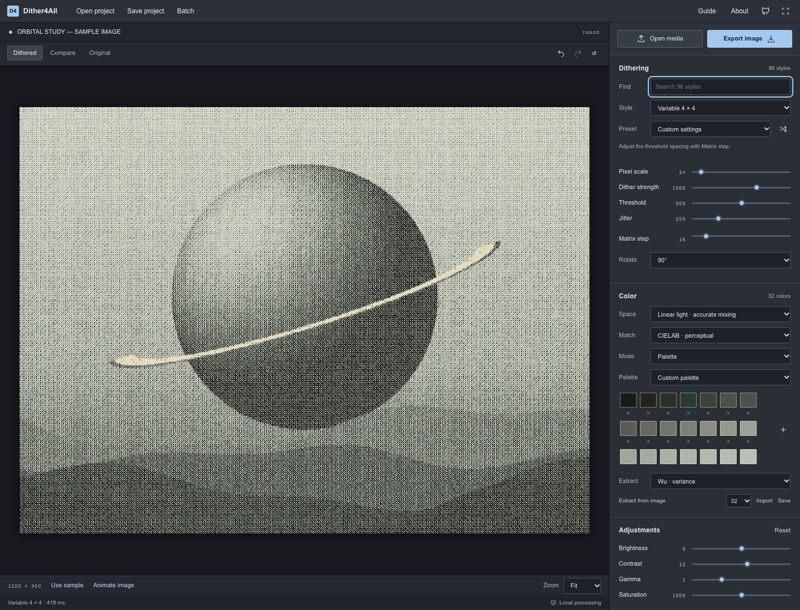

# Ditherista / libdither source audit

Reviewed 2026-10-15 at the user's request to adopt useful Ditherista features.

- [Ditherista](https://github.com/robertkist/ditherista): `24f1067f1af359e1a52fd9298f56300c4d181b66`, MIT.
- Its pinned [libdither](https://github.com/robertkist/libdither/tree/7bf49c5324b8b8d5ce321d549f89fb6c75a9d859) submodule: `7bf49c5324b8b8d5ce321d549f89fb6c75a9d859`, Robert Kist's BSD-style license with bundled notice requirements.
- Source inspected: README, help pages, GUI method dispatchers, `dither_*` methods/data, palette/quantization code and color models. No desktop application was installed or executed.



## Adopted

| Upstream capability        | Dither4All integration                                                                                                                                                                                                               |
| -------------------------- | ------------------------------------------------------------------------------------------------------------------------------------------------------------------------------------------------------------------------------------ |
| Ordered matrices           | All distinct fixed matrix definitions not already represented, plus CC0 blue noise, variable 2×2/4×4 and Kacker–Allebach. Rotation and variable matrix spacing exposed inline.                                                       |
| Additional fixed diffusion | Xot, diagonal, Shiau Fan 2, 1D, 2D, Steve Pigeon and Robert Kist kernels, preserving existing identifiers and output defaults.                                                                                                       |
| Variable diffusion         | Ostromoukhov and Zhou–Fang coefficient tables; original-tone selection, seeded noise and palette/color adaptations.                                                                                                                  |
| Dot diffusion              | Knuth, mini/optimized Knuth, Mese 8/16, Guo–Liu 8/16, spiral/inverted spiral. Floating-point weights and transparent/partial-edge handling.                                                                                          |
| Pattern tiles              | Six upstream binary tile sets with block matching. Uses darkest/lightest palette inks and processes partial edge blocks.                                                                                                             |
| Riemersma                  | Original and modified weighted error histories along a Hilbert curve. Traversal prunes out-of-image quadrants and covers every pixel, including the origin.                                                                          |
| Serpentine and jitter      | Independent controls across fixed/variable diffusion; deterministic jitter across applicable families. Legacy scanning aliases still load unchanged.                                                                                 |
| Linear color               | Optional linear-light downsampling, tonal processing and error diffusion; output re-encoded before effects. Classic sRGB remains the compatible default.                                                                             |
| Color matching             | Weighted RGB, RGB, CIELAB ΔE76, CIEDE2000 and luminance. Palette coordinates precomputed; CIEDE2000 equation independently implemented and reference-tested.                                                                         |
| Palette quantization       | Existing median cut plus new independent Wu and deterministic K-means implementations. Extraction runs in a worker. Palette capacity expanded to 256. K-means is our third method, not a claim to port upstream's KD-tree quantizer. |
| Workflow                   | Searchable style catalog, contextual method options, +/− zoom, period/double-click to fit, continuous inspector and scrollable large-palette swatches.                                                                               |
| Shared processing          | New image methods/settings also work in projects, presets, batch and motion exports through the shared worker.                                                                                                                       |

There are now 96 selectable styles, 64 newly added. Matrix variants and the three legacy serpentine aliases are counted as styles, not newly invented algorithm families. Original algorithms/presets are preserved.

## Deliberately outside this integration

- Direct Binary Search, Lippens/Philips, the additional L-system curves, and the specialized grid algorithm were inspected but not ported. They need separate fidelity/performance work; their names are not added as aliases for unrelated methods. DBS is particularly expensive for interactive video.
- Ditherista's native Qt windowing, installers, update checker, platform clipboard code, icons and sample artwork are desktop-specific and are not shipped.
- Full upstream color-model/illuminant/component-weight controls and its KD-tree quantizer are not reproduced. The browser exposes five explicit matching modes, D65 Lab, and three usable quantizers rather than claiming complete parity.
- Native encoding support does not change: browser codecs and the existing motion export limits still apply.

## Attribution and reproducibility

Numeric table extraction is reproducible with:

```sh
python3 scripts/import-ditherista.py /path/to/ditherista/libdither
npx prettier --write src/engine/ditherista/catalog.ts
```

The script verifies the exact reviewed revision and checks table dimensions/permutations. Generated data is intentionally excluded from Prettier. TypeScript code is a modified browser adaptation, including different RNG, palette/color extensions, preserved transparency, bounded traversal, valid-neighbor weighting and edge fixes. No pixel-identical upstream output claim is made.

[Runtime notices](../public/third-party-notices.txt), [libdither license](../public/licenses/libdither.txt), [required additional notices](../public/licenses/libdither-additional.txt), and [Ditherista MIT notice](../public/licenses/ditherista-MIT.txt) ship in the static app. The blue-noise texture is Christoph Peters' CC0 work. The mathematical CIEDE2000 implementation cites the published equation/test data; no restricted MATLAB code was copied.
