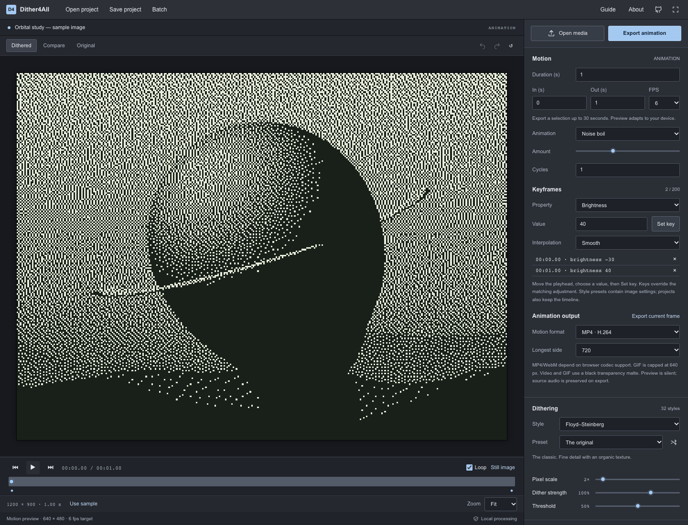

# Video and animation

Open a video with **Open media** or drop it onto the canvas. MP4, WebM, MOV and MKV containers are supported when the browser can decode their video codec. Or choose **Animate image** below the canvas to turn a still into an animation.

The same dithering, palette and effect stack applies to every frame. Preview is silent and adapts to device performance; export renders every frame at the chosen FPS. Use the timeline to scrub, step frames, play/pause, and loop. Space toggles playback when focus is outside a control.

## Trim and animate

Set In and Out in seconds. Selections must be between 0.01 and 30 seconds. Still-image duration can be changed up to 30 seconds. FPS choices are 6, 12, 24 and 30.

Under **Source motion**, choose None to preserve source movement, Noise boil for changing grain, Brightness pulse, Looping zoom, or Horizontal drift. Amount and cycles control these effects. Drift wraps the image horizontally; fractional traversals can jump on looping. Pulse and zoom cycle smoothly; random grain is intentionally discontinuous.

To animate an adjustment, move the playhead, select a property, enter its value and click Set key. Repeat at another time. Keys override the matching base adjustment; values hold before the first and after the last key. Interpolation can be smooth, linear or hold. Click a key in the list or a diamond below the timeline to seek; use × to remove it. Up to 200 keys are supported. Scale is rounded to whole pixels.

## One-click animation looks

The six **Animation looks** cards show animated thumbnails before you apply anything. They automatically use your current image and image recipe (palette, dithering, adjustments and static effects) in both built-in and selected saved/imported previews. Uploading another image or opening a project refreshes every thumbnail. Previews do not change the project or current animation. Thumbnails preserve image proportions and approximate texture at their small resolution. They loop over four seconds at 8 FPS and use base image settings rather than timeline adjustment keys. For video projects, thumbnails use the poster image, not moving video frames. Use **Pause previews** to stop them or **Play previews** to resume. Reduced-motion preferences start the cards as static posters; you can opt into playback. Cards pause off-screen, in hidden tabs, and during animation export.

Use **Preset strength** to preview all built-in and saved/imported looks from **0%** (no motion) through **100%** (original) to **200%** (boosted). It scales source-motion and stack amounts, capped at each effect's 100 limit, without changing phase, ordering or enabled layers. **Reset** returns to 100%. Moving the slider changes thumbnails only; click a look or **Apply preset** to put the previewed amounts into the editable stack. Reapplying always scales from the preset's original amounts, so it does not compound. Saving the applied stack captures those amounts as a new preset; sharing an existing preset keeps its original amounts. Strength is a temporary browsing control, while projects and exports use the applied stack.

Use **Preset speed** to preview a look at **0.25×–4×** its original pace. It combines with strength for both built-in and selected saved/imported previews, using the current image. **Reset** restores 1×. The slider only changes thumbnails until you apply a preset. Applying scales from the saved original speed each time, with the combined speed capped to 0.25×–4×. **Animation speed** below source motion shows the applied value and lets you edit it directly. Speed affects source motion (including noise boil) and every stack layer, while preserving cycle counts, phase, amounts, duration, trim, FPS, video/audio playback and adjustment-keyframe times. Thumbnails still use a four-second timeline; actual pace is relative to the project's selection length. Fractional speeds can end partway through a cycle and jump at the loop boundary; use whole effective cycles for seamless loops. Projects and newly saved/exported presets retain applied speed; older files default to 1×. Exporting an existing saved preset retains its original speed, regardless of the browsing slider.

Enable **Reverse preset direction** to preview the original look playing backward before applying it. This works with strength, speed, the current-image source and selected saved/imported presets. It flips the original saved direction: reversing an already reversed preset plays it forward. Reapplying does not repeatedly flip the current stack. The **Reverse animation** checkbox below source motion shows and edits the applied direction. Source-motion phase and stack progress run from the selection end toward its start; noise boil reverses its discrete exportable frame sequence. Image-adjustment keyframes, video/audio playback, trim, FPS and playhead keep their original timing. Applied direction survives project saves and preset sharing. Existing files without a direction flag default to forward. Selecting, previewing or exporting an existing saved preset leaves its original direction unchanged.

Under **Animation looks**, click a named look to replace source motion and the motion stack with a curated combination. Image settings (including palette and dithering), duration, trim, FPS, loop, playhead and adjustment keyframes stay unchanged. Playback continues if it was already running. The selected look is highlighted; editing its effect controls clears the highlight. Projects save the resulting editable settings, so the look survives reopening without a special preset format.

- **Liquid Ink:** flowing displacement and gentle ripples.
- **Signal Loss:** glitch bursts and CRT roll.
- **Aftershock:** expanding shockwaves and twist.
- **Mirror Lake:** subtle flow and water reflection.
- **Chromatic Tide:** palette cycling and flow. Available in Palette color mode.
- **Orbital Drift:** looping zoom, twist and subtle CRT shading.

These motion looks are separate from saved image style presets. Apply a look, press Play to watch it, then adjust individual layers as needed.

## Your saved animation presets

Under **Your animation presets**, click **Save**, enter a name, then save the current source-motion settings and ordered stack, including the applied animation speed and direction, disabled layers and each layer's amount, cycles and phase. Select a saved preset and click **Apply preset** to use it on any image or video. Applying it replaces source motion and the stack while preserving image settings, duration, trim, FPS, loop, playhead and adjustment keyframes.

Selecting a saved or imported preset shows **Selected preset preview** using the current image, just like the built-in looks. Selection only previews the look; click **Apply preset** to change the animation. **Pause all previews** / **Play all previews** beside the selected preview share playback state with the built-in preview control. Reduced motion defaults to a static poster. Previews stop off-screen, in hidden tabs and during animation export. Changing preview direction, speed, strength, the source image or the image recipe rebuilds cached frames without applying the preset. Renaming keeps the cached preview; selecting another appearance replaces its cache, and deleting clears the preview.

Use **Rename preset** to change the selected name, or **Delete preset** to remove it from the library. Deleting a preset leaves the current animation unchanged. Save creates a separate copy: editing the stack afterward does not update a saved preset. To save a variation, give it a new name. Names are trimmed, case-insensitively unique, and limited to 60 characters. You can keep up to 50 animation presets.

Presets stay in this browser for this site; they do not automatically sync between devices and clearing site data removes them. Export a JSON backup to keep them or move them to another browser. Projects still preserve the current animation separately. The preset library contains no source media, image recipes or timeline keys. Palette-dependent presets can only be applied in Palette color mode. Storage failures keep the name form open for retry, and an unreadable library is reported rather than replaced.

### Import and export animation presets

Select a saved preset and choose **Export selected** to share one look, or choose **Export all** to back up the entire library. Both download a JSON file containing names, source motion and effect stacks. Browser-local IDs, images, videos, image recipes and timeline keys are excluded.

Choose **Import presets** and select an exported JSON file to merge it into this browser's library. Imports create new copies and leave the current animation unchanged. Duplicate names, including case-insensitive matches, get numbered suffixes such as `Lake (2)`. Select an imported preset and click **Apply preset** when ready.

Files use `type: "dither4all-animation-presets"`, `version: 1`, and a `presets` array containing `name` and `appearance` for each entry. One file can contain 1–50 presets and must be at most 256 KB. Every entry must pass the same source-motion and effect validation used by the editor. Imports are all-or-nothing: malformed/unsupported files, capacity errors or storage failures leave the existing library unchanged. Delete unwanted presets if an import would exceed 50 saved presets; export a backup first if you want to keep them.

## Stackable motion effects

Choose an effect under **Motion stack** and click **Add effect**. Combine up to eight entries, including repeated effects. Entries run from top to bottom after the image's dithering and static effects. Toggle **Enabled**, use ↑ / ↓ to reorder, or × to remove an entry. Each entry has its own **Amount** (0–100), **Cycles** (1–8 over the selection), and **Phase** (0–360°). Zero amount and disabled entries leave pixels unchanged.

- **Flowing displacement:** smooth liquid distortion from seeded 4D simplex noise. Amount controls displacement distance.
- **Animated ripple:** traveling circular waves. Amount controls displacement distance.
- **Glitch bursts:** intermittent torn rows and RGB separation. Amount controls displacement and channel separation. Burst timing is seeded and repeatable.
- **CRT roll:** moving scanlines and a dark rolling band. Amount controls darkness.
- **Palette cycling:** steps colors through the palette in swatch order. Amount controls the proportion of pixels that cycle using a fixed ordered mask, preserving swatch colors. Requires **Palette** color mode; RGB mode skips this effect and shows a preview notice. Place it before CRT to keep the CRT shading, or after CRT to remap the shaded colors.

- **Shockwave:** a localized distortion ring expands from the center and resets after passing the corners. Amount controls displacement distance.
- **Twist:** the center winds and unwinds while the outer region stays still. Amount controls the rotation strength.
- **Water reflection:** mirrors the image into a water region with moving horizontal waves. Amount controls the water coverage (up to the lower half) and wave displacement. The image above the waterline stays unchanged.

Flow, ripple, CRT, shockwave, twist, and reflection have matching start/end states. Palette cycling is deliberately stepped and glitch bursts deliberately cut. Integer cycles repeat over the selection, and phase offsets each entry. Source motion and adjustment keyframes still work alongside the stack. The effect controls themselves are constant over a selection; numeric adjustment keyframes remain available below the stack.

Preview, current-frame export, and animation export evaluate the same worker code using the same FPS-aligned timestamps and seed. Scrubbing to the selection end shows the last exportable frame. At matching dimensions the processed pixels match; larger exports have more detail than the reduced preview. Video/GIF encoding can additionally change colors. Preview is capped at 640 px (lower for heavy methods) and never exceeds the selected export size.

## Export

**Export animation** uses Motion format and Longest side. Images are never enlarged. Dimensions are rounded to even pixels for codec compatibility.

- MP4: H.264 video with optional AAC audio.
- WebM: VP8 video with optional Opus audio.
- GIF: animated palettes, at most 640 px on the longest side; Loop determines the GIF repeat flag. Centisecond timing is distributed across frames.
- PNG frames: a ZIP of numbered PNGs plus `animation.json` with FPS, duration and loop metadata.

Video export preserves source audio when Include audio is checked. Unsupported audio encoders cause an explicit error; uncheck Include audio for silent export. Codec packet padding may extend the audio track slightly. GIF and PNG sequences have no audio. Preview looping does not make MP4/WebM players loop; that is controlled by the player.

Use **Export current frame** for a still at the current playhead, in the image Output format, at the selected motion resolution. Copy image also copies the current processed frame. The image Output Size applies only to still documents.

Export is limited to 30 seconds and 900 frames, with longest-side choices 128, 256, 480, 720 and 1280 px. GIF/PNG collections stop at 120 MB. Browser-native video encoders may be unavailable on some browsers/devices: choose another format. Export uses a snapshot of settings and can be cancelled; source files cannot be changed during export. Video and GIF flatten transparency onto black; PNG frames retain it. All output is assembled in browser memory before download.

## Projects and privacy

Save project retains image settings, the ordered motion stack and its controls, source motion, trim and keyframes. Older projects open with an empty motion stack. Still projects embed the source image. Video projects embed a poster and a file reference, so reopen the original video (matching filename and size) after loading the project. Video bytes are not embedded. Keep your original file alongside the project.

Style presets, settings links, and image undo/redo affect the image recipe. Motion keys/settings are edited in the timeline and saved in projects. Animated image imports currently use one frame; video containers provide moving sources. There is no multi-track editing, motion tracking, transition editor or automatic subject segmentation.

Everything runs locally with bundled libraries. No upload, account, API key, remote codec service, microphone access or recording permission is required. See [licenses](../public/third-party-notices.txt).

## Heavy methods

DBS, curves, Lippens–Philips, grid and auto-threshold enforce tighter working-grid/frame-count limits and a 90-second motion-export deadline. DBS is limited to 12 FPS. Use the new 128/256 px sizes, shorten the selection or increase Pixel scale. Preflight considers low-scale keyframes too. See [the full budget table](performance-limits.md). Cancel preview pauses playback and stops its worker; settings changes can start it again.
