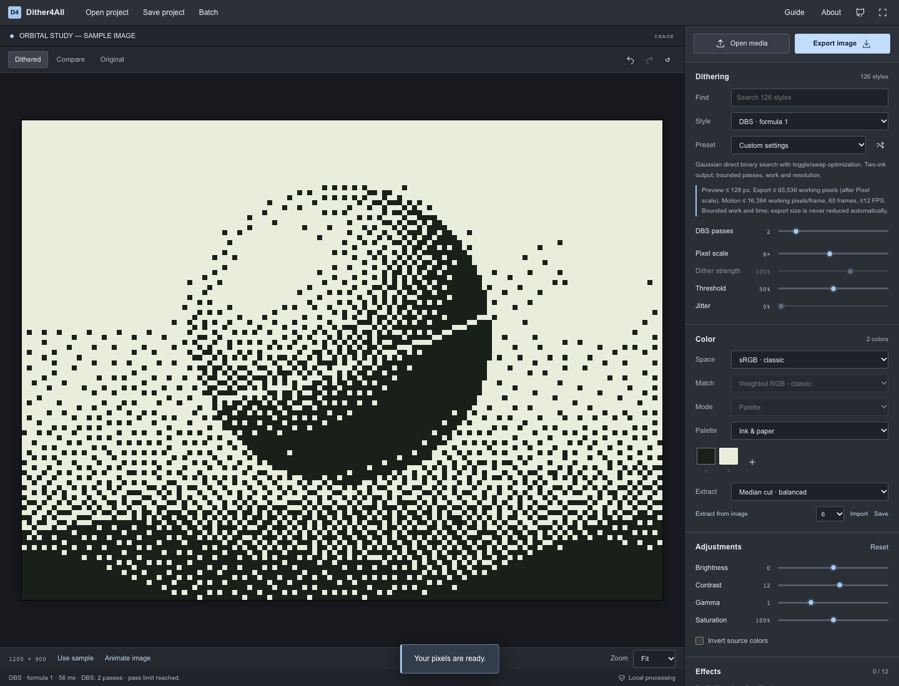

# Bounded dithering methods

Every dithering family used by Ditherista's mono/color dispatchers is now represented. Version 0.4 adds DBS, six Lippens–Philips variants, all seven previously missing L-system curve definitions (both history variants), both grid modes and automatic thresholding. There are 126 selectable styles. Four palette extractors include the upstream KD-tree approach alongside median cut, Wu and our weighted K-means.

## Limits you can see

Working pixels are `ceil(output width / Pixel scale) × ceil(output height / Pixel scale)`. Increasing Pixel scale reduces the working grid while keeping the selected output dimensions. Changing Output Size explicitly resizes the output. Exports are never automatically downscaled to pass a budget.

| Method                       | Preview longest side | Still working pixels | Motion working pixels/frame | Maximum motion frames |
| ---------------------------- | -------------------: | -------------------: | --------------------------: | --------------------: |
| DBS (7 formulas)             |               128 px |               65,536 |                      16,384 |                    60 |
| Curve diffusion (all curves) |               384 px |              262,144 |                      65,536 |                   240 |
| Lippens–Philips (6 variants) |               480 px |              524,288 |                     131,072 |                   360 |
| Grid / automatic threshold   |               640 px |            1,000,000 |                     262,144 |                   600 |

DBS motion is additionally capped at 12 FPS. Heavy motion jobs have a 90-second deadline. The existing general limits (16 MP still input, 30 seconds/900 frames and 1280 px motion output) remain upper bounds; the stricter method limit wins. New 128/256 px motion size choices make smaller exports straightforward.

For example, a 1200×900 still at Pixel scale 2 exceeds the DBS limit. At scale 5 its 240×180 working grid fits, and its exported PNG remains 1200×900. A 256×192 motion output at scale 2 uses 12,288 working pixels per frame and fits the DBS frame-size limit. At 12 FPS, select no more than five seconds (60 frames).

Motion preflight considers the smallest base/keyframed Pixel scale, conservatively including keys outside the selection. It checks before codec setup/rendering. Trim or remove an irrelevant low-scale key if it prevents an otherwise valid selection.

## CPU and cancellation

- Processing runs in workers, including preview, still export, batch, current-frame export and motion frames.
- DBS has 1–8 passes (default 2), then returns a valid bounded approximation. Its result reports whether it converged or reached the pass limit. No claim of global optimality is made.
- Counted work-unit budgets are 90 million for DBS, 12 million for curves, 30 million for Lippens and 24 million for grid/threshold. Units count algorithm work, not literal CPU instructions. Exceeding a work budget rejects the job instead of exporting a partial result.
- Heavy methods check worker wall time (3 seconds for previews, 8 seconds for exports) at regular operation checkpoints. A separate main-thread watchdog terminates an unresponsive worker after 5/12 seconds respectively, covering code that never reaches a checkpoint. Other methods also have a 60-second worker watchdog.
- Cancel preview terminates the current worker and pauses playback. Cancel export terminates pending processing; batch and motion retain their own cancellation controls. Changing image settings cancels stale preview work; motion setting changes also terminate stale processing while normal playback reuses its worker.
- Watchdog failures are recoverable. Adjust the scale/output settings and render again; a fresh worker is created.

These are deliberately conservative bounds. Worker startup, decoding, image preparation and effects take time too; a pass or pixel count cannot guarantee a fixed rendering time on every device. All output is still assembled in browser memory. The app reports budget failures explicitly rather than promising an unlimited render.

## Implementation and fidelity

DBS uses the seven upstream Gaussian-filter formulas, a 13×13 autocorrelation, and genuine bit-toggle/neighbor-swap error minimization. It starts from a threshold image for faster useful bounded results, preserves transparency and weights partial opacity in the error objective. This differs from the native all-black initialization and unbounded convergence loop.

Lippens uses the original class/5×5 coefficient tables. Rank buckets replace 256 full-image rescans. Diffusion goes only to later, visible classes, fixing the upstream comparison against the horizontal offset. All six native dispatcher variants are exposed.

Curves use exact upstream axioms, rewrite rules and initial orientation. Cached subtree bounds let the traversal skip out-of-image regions without allocating expanded strings. In-bounds pixels are visited once. Any geometric holes are matched independently, with a result notice stating the count; a different curve is never silently substituted. Crop/centering and origin coverage are corrected browser adaptations, not a byte-identical native output promise.

Grid uses seeded draws or a finite shuffle of valid cell positions. Partial cells exclude missing/transparent pixels, zero ink stays zero, and solid endpoints are preserved. Automatic thresholding follows the upstream mean/range/gamma approach, with seeded jitter and hidden pixels excluded.

KD-tree palette extraction uses unique colors, at most 10 refinement passes and deterministic finite initialization. Small/solid inputs cannot get stuck searching for more unique initial colors than exist. It runs in the palette worker and is separate from frequency-weighted K-means.

Licenses, pinned source revisions and original authors are listed in the [source audit](ditherista-audit.md) and [runtime notices](../public/third-party-notices.txt).
